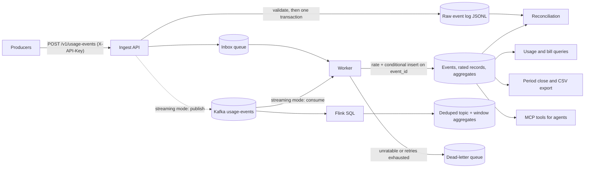

# Agentic Usage Billing Engine

An event-driven, idempotent and auditable **usage-based billing pipeline**. Producers
send usage events; the engine deduplicates them, rates them against a versioned price
book, aggregates them per customer and billing period, and serves bills that can be
reconciled at any time against an immutable raw event log. Read-only **MCP tools** let
AI agents answer billing questions over the same data.

> **Status: v0.1 proof of concept.**
> - **Working and verified:** the full pipeline runs locally (`make api` + `make worker`),
>   in Docker (`make up`), and as a **Kafka + Flink streaming stack** inside the *same*
>   Compose project (`make up-streaming`; proven by `make stream-smoke`). 280 gating
>   tests plus 3 opt-in perf tests, 100% line and branch coverage, a 10-eval
>   correctness suite, performance targets measured against live processes, and
>   containerised end-to-end smoke tests.
> - **Blueprint only:** the AWS deployment in `infra/cdk/` describes the target
>   architecture but is **not yet deployable**; the local Kafka/Flink runtime maps to
>   Amazon MSK + Managed Service for Apache Flink. See
>   [AWS deployment](#aws-deployment-blueprint).

## Contents

- [Highlights](#highlights)
- [Architecture](#architecture)
- [Domain model](#domain-model)
- [Prerequisites](#prerequisites)
- [Quick start](#quick-start)
- [Configuration](#configuration)
- [API reference](#api-reference)
- [End-to-end test walkthrough](#end-to-end-test-walkthrough)
- [MCP and agentic interface](#mcp-and-agentic-interface)
- [Streaming, partitions and ordering](#streaming-partitions-and-ordering)
- [Data lake](#data-lake)
- [Agentic governance](#agentic-governance)
- [Testing and quality](#testing-and-quality)
- [Operations](#operations)
- [Make targets](#make-targets)
- [Project layout](#project-layout)
- [AWS deployment (blueprint)](#aws-deployment-blueprint)
- [Troubleshooting](#troubleshooting)
- [Roadmap and non-goals](#roadmap-and-non-goals)
- [Documentation index](#documentation-index)
- [License](#license)

## Highlights

- **Exactly-once effect on at-least-once delivery.** Every event carries a
  producer-supplied `event_id`; the processor's conditional insert on that key makes
  redelivered and duplicated events harmless. 10% injected duplicates produce zero
  double-billing.
- **Versioned, deterministic rating.** Flat and tiered plans with included allowances,
  loaded from `price_plans.json`; every rated record carries the plan version that
  priced it.
- **Reconciliation as a built-in control.** Totals are recomputed from the append-only
  raw log and compared with the stored aggregates, over HTTP, the CLI or MCP.
- **Period close with late-event handling.** Closing a period freezes the bill and
  exports a CSV; usage that arrives afterwards is reported as `post_close_delta`
  instead of silently changing a closed invoice.
- **Operable from day one.** Structured JSON logs, latency percentiles, queue depth,
  dead-letter queue (DLQ) depth and alarm evaluation at `GET /v1/ops/metrics`, plus
  SLOs and a runbook.
- **Agent-ready.** An MCP server exposes `get_usage`, `get_bill`, `reconcile`,
  `explain_charge` and `agentic_decision` as read-only tools.
- **Event-Driven Resilience.** Deterministic rating on high-throughput streams:
  jump-consistent partitioning (20 → 40 moves ~50% of keys, one owner per key,
  never split), epoch-fenced cutover that rejects stale producers, per-key
  sequencing for duplicates/gaps, watermark-bounded reordering across partitions,
  and SHA-256 checksum chains that trace and repair broken order. Crash-safe
  ingestion (transactional raw-log + inbox insert) and DLQ redrive guarantee zero
  lost events. See [docs/STREAMING.md](docs/STREAMING.md).
- **Runnable Kafka + Flink runtime, embedded in the same stack.** One Compose
  project is the whole solution: `docker-compose.yml` runs the monolith
  (API + worker) and, with the `streaming` profile, adds Kafka 3.8 (KRaft, 20
  partitions) and Flink 1.19 SQL jobs. One variable
  (`BILLING_KAFKA_BOOTSTRAP`) switches the API *and* the worker to the Kafka
  queue, so the same images, database and volume serve both modes. `make
  up-streaming` starts it; `make stream-smoke` proves bill correctness,
  reconciliation, dedupe and aggregation end to end. See
  [infra/streaming/README.md](infra/streaming/README.md).
- **Agentic Workflows & MCP.** Integrated coding agents and Model Context Protocol
  (MCP) tooling embedded directly into the developer and validation lifecycle.
  `agentic_decision` combines usage, rated bills and reconciliation status into a
  structured answer with evidence; skills under [skills/](skills/) cover bill
  investigation, reconciliation audit and incident response.
- **Production Guardrails.** A 10-eval correctness suite, strict CI/CD gates
  (100% line+branch coverage, clean lint, no TODO/FIXME, reconcile proof),
  HMAC-signed deployment verdicts, risk-tiered human review and OTLP/HTTP
  OpenTelemetry export. See [docs/GOVERNANCE.md](docs/GOVERNANCE.md).
- **Auditable data lake.** Immutable partitioned files with atomic snapshot
  manifests, partition pruning, time travel, compaction and per-file checksums —
  Iceberg-shaped and format-neutral (Iceberg/Delta/Hudi catalog properties).
  See [docs/DATALAKE.md](docs/DATALAKE.md).

## Architecture



**Flow.** Ingest validates each event and appends it to the raw log. In the default
local mode it also enqueues the event in SQLite in the same transaction; in streaming
mode it publishes to Kafka and skips the inbox. It returns `202 Accepted` either way,
so ingest stays fast and a broker failure never loses an event. The worker — one
entry point that polls the SQLite inbox or consumes the Kafka topic, depending on
`BILLING_KAFKA_BOOTSTRAP` — rates each event and inserts it only if its `event_id` has
not been seen; duplicates are acknowledged and dropped, and events that cannot be
rated go to the DLQ. Flink maintains a deduped analytics read model and 10-second
operational aggregates from the Kafka topic; invoice totals still come from the
ledger. Bills are computed from the aggregates; reconciliation replays the raw log
and must match them exactly.

**Local vs. target AWS mapping**

| Concern | Local implementation (working) | AWS target (blueprint) |
|---|---|---|
| HTTP ingress and auth | FastAPI + `X-API-Key` header | API Gateway REST + usage-plan API keys |
| Ingest | `ingest.py` in the API process | Ingest Lambda |
| Queue and DLQ | SQLite inbox/DLQ (default) or Kafka `usage-events`/`usage-events-dlq` (streaming) | SQS standard queue + DLQ (5 receives) |
| Processing | `worker.py` polling loop or `kafka_worker.py` | Processor Lambda (SQS event source, batch 50) |
| Streaming transport | Kafka 3.8 KRaft, 20 partitions, key `customer_id` | Amazon MSK (KRaft), 3 AZs, RF 3 |
| Streaming analytics | Flink 1.19 SQL: dedupe + 10 s aggregates | Amazon Managed Service for Apache Flink |
| Event, rated and aggregate store | SQLite (WAL) | DynamoDB tables |
| Immutable raw log | JSONL files | S3 bucket with lifecycle rules |
| Metrics and alarms | In-process counters, `/v1/ops/metrics` | CloudWatch metrics and alarms |

**Key design decisions** (details in [docs/ARCHITECTURE.md](docs/ARCHITECTURE.md) and
[docs/ADRS/](docs/ADRS/)):

1. **Idempotent consumer instead of exactly-once transport**: a conditional insert on
   `event_id` gives exactly-once *effect*
   ([ADR-001](docs/ADRS/ADR-001-idempotency.md)).
2. **Two-level rating**: an immutable per-event estimate plus an authoritative
   period-level settlement, because allowances and tiers apply to period totals
   ([ADR-002](docs/ADRS/ADR-002-rating.md)).
3. **Raw log as the source of truth**: aggregates are derived and rebuildable, so
   reconciliation is always possible ([ADR-003](docs/ADRS/ADR-003-audit.md)).
4. **Bucket by event time, not arrival time**: late and out-of-order events land in the
   correct period.
5. **Thin synchronous ingest, asynchronous processing**: the queue absorbs bursts and
   keeps ingest latency low.
6. **Kafka is a transport, not the billing authority**: the raw log is durable before
   publish, and the ledger dedupes at-least-once delivery. Flink topics are read
   models, not invoice inputs.

## Domain model

### Usage event

| Field | Type | Rules |
|---|---|---|
| `event_id` | string | Required, 1-128 chars, whitespace trimmed. Idempotency key; a UUID is recommended. |
| `customer_id` | string | Required, 1-128 chars, trimmed. |
| `product_id` | string | Required, 1-128 chars, trimmed. |
| `metric` | string | Required, 1-64 chars, trimmed. Must have a price plan, otherwise the event goes to the DLQ. |
| `quantity` | number | Required, `> 0` and `<= 1,000,000,000`. Booleans are rejected. |
| `timestamp` | ISO-8601 | Required. Event time; naive timestamps are treated as UTC. Determines the billing period (`YYYY-MM`). |
| `metadata` | object | Optional. Values are never logged, only key names. |

### Price book (`src/billing_engine/price_plans.json`, version `2026-10-v1`)

| Metric | Type | Included per period | Price |
|---|---|---|---|
| `cloud_credits` | flat | 0 | $0.10 per credit |
| `render_minutes` | tiered | 100 minutes | $0.05 for the first 1,000 billable minutes, $0.04 up to 10,000, then $0.03 |
| `inference_tokens` | flat | 1,000,000 tokens | $0.000002 per token |

Rating is applied to the **period total** for each customer and metric: the allowance is
subtracted first, then the remaining billable quantity is priced (marginally, for tiered
plans). Example: 150 `render_minutes` in a period is 50 billable minutes x $0.05 =
**$2.50**. Each event also stores a unit estimate (quantity x first-tier price) for
auditability; the worker log shows that estimate, not the final bill.

### Lifecycle rules

- **Duplicates.** Re-sending an `event_id` returns `202` again, but the event is billed
  once. The duplicate is counted in the processor metrics.
- **Dead-letter queue.** Events with an unknown metric, or that exceed 5 processing
  attempts, move to the DLQ. They are excluded from bills and from reconciliation, and
  a positive DLQ depth raises the `DLQDepthPositive` alarm.
- **Period close.** `POST /v1/customers/{cid}/close?period=YYYY-MM` freezes the bill
  (`status: "closed"`) and writes `bill-<customer>-<period>.csv`. Events for that period
  that arrive later are still recorded and reconciled, and the bill reports them as
  `post_close_delta` (amount) while the frozen total stays unchanged.

## Prerequisites

- **Python 3.10+** (3.12 is what CI and the test reports use) and `pip`.
- **GNU make** (the macOS system make 3.81 works).
- **Docker Desktop** with Compose v2.24+ (optional, for the containerised stack and
  the Kafka + Flink runtime; allocate at least ~4 GB to Docker).
- `curl` for the command-line examples.

## Quick start

```bash
git clone <repo-url> Agentic-Usage-Billing-Engine && cd Agentic-Usage-Billing-Engine
python3 -m venv .venv && source .venv/bin/activate
pip install -r requirements.txt
```

The package is not pip-installed; the Makefile puts `src/` on `PYTHONPATH` for every
target.

| Option | Commands | Notes |
|---|---|---|
| **A. Docker** | `make up` | Builds the image, starts API + worker, waits until healthy. Stop with `make down`. |
| **B. Local processes** | `make api` (terminal 1), `make worker` (terminal 2) | Data in `./data`, CSV exports in `./exports`. Stop with Ctrl+C. |
| **C. Tests only** | `make test` | No server needed. |
| **D. Kafka + Flink** | `make up-streaming` (alias `make stream-up`), then `make stream-smoke` | The same Compose project with the `streaming` profile: Kafka (KRaft) + Flink SQL, and the API/worker in Kafka mode. API on <http://localhost:8000>, Flink UI on <http://localhost:8081>, Kafka on `localhost:29092`. Stop with `make down`. |

Either A or B serves the API at <http://localhost:8000>. Use `make up PORT=9000` or
`make api PORT=9000` if port 8000 is taken. Option D is the *same* project with the
`streaming` profile: the API and the worker switch to Kafka, the raw log stays the
source of truth, and the SQLite database and volume are unchanged. The end-to-end
smoke (`make stream-smoke`) runs in an isolated project on port 18000, so it never
touches a running stack.

## Configuration

All settings are environment variables (see `src/billing_engine/config.py`).
`.env.example` lists them; `.env` is optional.

| Variable | Default (local) | In Docker | Purpose |
|---|---|---|---|
| `BILLING_API_KEY` | `dev-key-123` | same (overridable) | Required value of the `X-API-Key` header |
| `BILLING_DB_PATH` | `data/billing.db` | `/data/billing.db` (named volume) | SQLite database |
| `BILLING_RAW_LOG_DIR` | `data/raw-log` | `/data/raw-log` (named volume) | Append-only raw event log |
| `BILLING_EXPORT_DIR` | `exports` | `/data/exports` = host `./data/exports` | Period-close CSVs |
| `BILLING_PLAN_PATH` | `src/billing_engine/price_plans.json` | same, inside the image | Price book |
| `BILLING_STAGE` | `local` | `local` | Reported by `/health` |
| `LOG_LEVEL` | `INFO` | `INFO` | Reserved; not applied yet |
| `PORT` | `8000` | `8000` | Host port for `make api`, `make up`, `make load` |
| `DATA_DIR` | - | `./data` | Host folder whose `exports/` subfolder receives CSVs |
| `BILLING_KAFKA_BOOTSTRAP` | empty (disabled) | `kafka:9092` in `make up-streaming` | Non-empty switches the whole deployment to Kafka: the API publishes + raw log (no SQLite inbox) and the worker consumes the topic |
| `BILLING_KAFKA_TOPIC` | `usage-events` | same | Topic the API publishes to and the worker consumes |
| `BILLING_KAFKA_DLQ_TOPIC` | `usage-events-dlq` | same | Topic for poison/non-retryable events |
| `BILLING_KAFKA_GROUP` | `billing-worker` | same | Consumer group for the worker in Kafka mode |
| `BILLING_KAFKA_OFFSET_RESET` | `earliest` | `earliest` | Where a new consumer group starts |
| `BILLING_KAFKA_PROPERTIES` | `{}` | `{}` | Extra `confluent-kafka` client properties as JSON |

In Docker, the database paths are fixed in `docker-compose.yml` and take precedence
over `.env`, so both containers always share one database. Kafka is only enabled when
`BILLING_KAFKA_BOOTSTRAP` is set; `make up` clears it explicitly, so the monolith
never depends on a broker, and the local modes keep the SQLite inbox.

## API reference

Interactive documentation: <http://localhost:8000/docs> (Swagger UI) and
<http://localhost:8000/openapi.json>. If `/docs` renders blank, your network is
blocking its CDN assets — use the dependency-free test console at
<http://localhost:8000/ui> instead: same operations (ingest, batch, usage, bill,
close, metrics, reconcile), no external requests.

**Authentication.** Every `/v1` route requires the header `X-API-Key: dev-key-123`. In
`/docs`, click **Authorize**, enter the key once, and every "Try it out" request sends
it. The key is never accepted in the URL, so `/v1` URLs typed into a browser address
bar return `401` by design.

| Method | Path | Auth | Success | Errors |
|---|---|---|---|---|
| GET | `/ui` | none | 200 self-contained test console (no CDN) | - |
| GET | `/health` | none | 200 `{"ok": true, "stage", "version"}` | - |
| POST | `/v1/usage-events` | key | 202 `{"event_id", "status": "accepted"}` | 400 invalid event, 401 |
| POST | `/v1/usage-events:batch` | key | 202 `{"accepted", "rejected", "accepted_count", "rejected_count"}` | 400 empty or more than 100 events, 401, 422 malformed body |
| GET | `/v1/customers/{cid}/usage?period=YYYY-MM` | key | 200 per-metric totals | 401, 422 missing or invalid period |
| GET | `/v1/customers/{cid}/bill?period=YYYY-MM` | key | 200 rated lines, total, status, `post_close_delta` | 401, 422 |
| POST | `/v1/customers/{cid}/close?period=YYYY-MM` | key | 200 `{"bill", "csv"}` | 401, 422 |
| GET | `/v1/ops/metrics` | key | 200 counters, latency percentiles, queue, alarms | 401 |
| GET | `/v1/ops/reconcile?customer=&period=` | key | 200 `{"match", "checked", "mismatches", ...}` | 401, 422 |
| GET | `/v1/ops/ledger-integrity` | key | 200 `{"events", "unique_events", "duplicates", "digest", "breaks"}` | 401 |

Batch requests are validated per event: valid events are accepted and invalid ones are
listed in `rejected` (partial accept). Append `?sync=true` to either ingest route to
process the queue inline before responding in the default SQLite mode; in Kafka mode
the worker consumes asynchronously. Tests and demos use `sync=true` for
determinism.

## End-to-end test walkthrough

This walkthrough exercises the whole system through its public interfaces. Every step
lists the URL, what to enter in `/docs`, the equivalent `curl` command, and the expected
result. It uses the fixed period `2026-10` and new customers (`demo`, `studio`), so
results are predictable on a fresh stack.

### Step 0: start a fresh stack

```bash
cd Agentic-Usage-Billing-Engine
make docker-reset   # optional: wipe any previous Docker data
make up             # wait for "Container ...-api-1 Healthy" and "...-worker-1 Healthy"
```

Without Docker, run `make api` and `make worker` in two terminals instead (delete
`data/billing.db*`, `data/raw-log` and `exports/` first for a clean start).

For the `curl` commands, set two shell variables once:

```bash
B=http://localhost:8000
K="X-API-Key: dev-key-123"
```

### Steps 1-3: public URLs and authorization

| Step | Open | Expected |
|---|---|---|
| 1 | <http://localhost:8000/health> | `{"ok":true,"stage":"local","version":"0.1.0"}` |
| 2 | <http://localhost:8000/openapi.json> | The OpenAPI 3.1 schema, including the `APIKeyHeader` security scheme |
| 3 | <http://localhost:8000/docs> | Swagger UI. Click **Authorize**, enter `dev-key-123`, click **Authorize**, then **Close**. The lock icons on the `/v1` routes close. If the page is blank (CDN blocked), use <http://localhost:8000/ui> — same operations, no setup needed beyond the API-key field. |

For each following step: expand the endpoint in `/docs`, click **Try it out**, enter the
values shown, and click **Execute**.

### Step 4: ingest one event

`POST /v1/usage-events` with body:

```json
{"event_id": "demo-001", "customer_id": "demo", "product_id": "design-suite",
 "metric": "cloud_credits", "quantity": 10, "timestamp": "2026-10-09T10:00:00Z"}
```

```bash
curl -s -X POST $B/v1/usage-events -H "$K" -H 'Content-Type: application/json' \
  -d '{"event_id":"demo-001","customer_id":"demo","product_id":"design-suite","metric":"cloud_credits","quantity":10,"timestamp":"2026-10-09T10:00:00Z"}'
```

Expected: **202** `{"event_id":"demo-001","status":"accepted"}`.

### Step 5: send the same event again (idempotency)

Repeat step 4 with the identical body. Expected: **202** again. The worker logs
`processor_duplicate` (`make logs`), and step 7 still shows one event.

### Step 6: batch ingest with tiered pricing

`POST /v1/usage-events:batch` with body:

```json
{"events": [
  {"event_id": "studio-001", "customer_id": "studio", "product_id": "render-studio",
   "metric": "render_minutes", "quantity": 100, "timestamp": "2026-10-09T11:00:00Z"},
  {"event_id": "studio-002", "customer_id": "studio", "product_id": "render-studio",
   "metric": "render_minutes", "quantity": 50, "timestamp": "2026-10-09T12:00:00Z"},
  {"event_id": "demo-001", "customer_id": "demo", "product_id": "design-suite",
   "metric": "cloud_credits", "quantity": 10, "timestamp": "2026-10-09T10:00:00Z"}
]}
```

```bash
curl -s -X POST $B/v1/usage-events:batch -H "$K" -H 'Content-Type: application/json' -d '{"events":[
 {"event_id":"studio-001","customer_id":"studio","product_id":"render-studio","metric":"render_minutes","quantity":100,"timestamp":"2026-10-09T11:00:00Z"},
 {"event_id":"studio-002","customer_id":"studio","product_id":"render-studio","metric":"render_minutes","quantity":50,"timestamp":"2026-10-09T12:00:00Z"},
 {"event_id":"demo-001","customer_id":"demo","product_id":"design-suite","metric":"cloud_credits","quantity":10,"timestamp":"2026-10-09T10:00:00Z"}]}'
```

Expected: **202** with `"accepted_count":3,"rejected_count":0`. The third event is a
duplicate of step 4; it is accepted at ingest and dropped by the worker.

### Step 7: usage

`GET /v1/customers/{cid}/usage` with `cid` = `demo`, `period` = `2026-10`, or
`curl -s "$B/v1/customers/demo/usage?period=2026-10" -H "$K"`.

Expected: one `cloud_credits` line with `"total_quantity":10.0,"event_count":1`, even
though `demo-001` was sent three times.

### Step 8: bills

`GET /v1/customers/{cid}/bill`, `period` = `2026-10`:

| `cid` | Expected |
|---|---|
| `demo` | `cloud_credits`: 10 billable x $0.10, `"total_amount":1.0`, `"status":"open"` |
| `studio` | `render_minutes`: 150 total, 50 billable after the 100-minute allowance, `"total_amount":2.5` |

```bash
curl -s "$B/v1/customers/demo/bill?period=2026-10"   -H "$K"
curl -s "$B/v1/customers/studio/bill?period=2026-10" -H "$K"
```

### Step 9: operational metrics

`GET /v1/ops/metrics`, or `curl -s $B/v1/ops/metrics -H "$K"`.

Expected: `"queue":{"pending":0,"dlq":0,...}` and `"alarms":[]`, plus ingest counters
and `ingest_ms` latency percentiles. The counters belong to the API process; the queue
figures are read from the shared database.

### Step 10: reconciliation

`GET /v1/ops/reconcile` with `period` = `2026-10`, or
`curl -s "$B/v1/ops/reconcile?period=2026-10" -H "$K"`.

Expected: `"match":true`, `"mismatches":[]`, `"checked":2` (one aggregate each for
`demo` and `studio`), `"raw_events_scanned":5` (every accepted request, including the two
duplicates).

The same check from the CLI:

```bash
docker compose exec api python -m billing_engine.reconcile --period 2026-10   # Docker
make reconcile                                                                # local
```

`make reconcile` checks the current calendar month.

### Step 11: close the period

`POST /v1/customers/{cid}/close` with `cid` = `demo`, `period` = `2026-10`, or
`curl -s -X POST "$B/v1/customers/demo/close?period=2026-10" -H "$K"`.

Expected: **200** with `"status":"closed"`, `"total_amount":1.0` and
`"csv":"/data/exports/bill-demo-2026-10.csv"`. The file appears on the host at
`data/exports/bill-demo-2026-10.csv` (Docker) or `exports/bill-demo-2026-10.csv` (local):

```text
customer_id,period,metric,total_quantity,billable_quantity,amount,plan_version
demo,2026-10,cloud_credits,10.0,10.0,1.0,2026-10-v1
demo,2026-10,TOTAL,,,1.0,
```

### Step 12: late event after close

Send another event for the closed period (step 4's body with `"event_id": "demo-late"`),
then fetch the bill again:

```bash
curl -s -X POST $B/v1/usage-events -H "$K" -H 'Content-Type: application/json' \
  -d '{"event_id":"demo-late","customer_id":"demo","product_id":"design-suite","metric":"cloud_credits","quantity":10,"timestamp":"2026-10-09T15:00:00Z"}'
curl -s "$B/v1/customers/demo/bill?period=2026-10" -H "$K"
```

Expected: the bill stays `"status":"closed"` with `"total_amount":1.0`, and
`"post_close_delta":1.0` reports the late usage. Usage (step 7) now shows 20 credits from
2 events, because usage is always live and only the bill is frozen. Reconciliation
(step 10) still returns `"match":true`.

### Step 13: negative checks

| Check | How | Expected |
|---|---|---|
| Missing API key | Open <http://localhost:8000/v1/customers/demo/bill?period=2026-10> in the browser | **401** `{"detail":"invalid API key"}` |
| Wrong API key | In `/docs`, Authorize, Logout, enter any other value, retry step 7 | **401** |
| Invalid event | Step 4 with `"quantity": -5` (or `"metric": ""`) | **400** with the validation error |
| Invalid period | Step 7 with `period` = `2026-13` | **422** |
| Oversized batch | A batch with 101 events | **400** `batch must contain 1..100 events` |
| Unpriced metric | Step 4 with `"event_id": "demo-bad"`, `"metric": "api_calls"` | **202** at ingest, then the worker moves it to the DLQ: step 9 shows `"dlq":1` and a `DLQDepthPositive` alarm; reconciliation still matches (`"dlq_excluded":1`) |

### Step 14: agent interface

```bash
docker compose exec api python -m billing_engine.agent_demo \
  --customer demo --period 2026-10 --event demo-001        # Docker
python -m billing_engine.agent_demo --customer demo --period 2026-10 --event demo-001   # local, with PYTHONPATH=src
```

Expected: five billing questions answered from the live data, ending in
`Result: 5/5 answered`. To connect a real MCP client, see the next section.

### Step 15: automated equivalents and teardown

| Command | What it proves |
|---|---|
| `make compose-smoke` | Steps 1-12 against a throwaway Docker stack (port 18000), plus a cross-container SQLite lock check |
| `make e2e` | Cross-process tests: real uvicorn, worker and MCP stdio server |
| `make demo` | Ingest, duplicates, bill, close and reconcile in one script |
| `make chaos` | Worker crash mid-batch, 10% duplicates and a late event: 0 double-counts, 0 lost |

Stop with `make down` (keeps data) or `make docker-reset` (also deletes the database).
Locally, press Ctrl+C in both terminals.

## MCP and agentic interface

`src/billing_engine/mcp_server.py` is a stdio MCP server (FastMCP) with read-only tools:

| Tool | Arguments | Returns |
|---|---|---|
| `get_usage` | `customer_id`, `period` | Per-metric usage totals |
| `get_bill` | `customer_id`, `period` | Rated bill: lines, total, status |
| `reconcile` | `customer_id` (optional), `period` (optional) | Raw-log replay vs. aggregates |
| `explain_charge` | `customer_id`, `event_id` | The event, its rated record and its bill line |
| `agentic_decision` | `customer_id`, `period`, `question` | Structured billing answer with evidence |

**Client configuration** (Cursor `~/.cursor/mcp.json` or Claude Desktop
`claude_desktop_config.json`). Against the Docker stack:

```json
{
  "mcpServers": {
    "billing-engine": {
      "command": "docker",
      "args": ["compose", "-f", "/ABSOLUTE/PATH/Agentic-Usage-Billing-Engine/docker-compose.yml",
               "exec", "-T", "api", "python", "-m", "billing_engine.mcp_server"]
    }
  }
}
```

Against the local stack (`make api` + `make worker`):

```json
{
  "mcpServers": {
    "billing-engine": {
      "command": "python",
      "args": ["-m", "billing_engine.mcp_server"],
      "env": {
        "PYTHONPATH": "/ABSOLUTE/PATH/Agentic-Usage-Billing-Engine/src",
        "BILLING_DB_PATH": "/ABSOLUTE/PATH/Agentic-Usage-Billing-Engine/data/billing.db",
        "BILLING_RAW_LOG_DIR": "/ABSOLUTE/PATH/Agentic-Usage-Billing-Engine/data/raw-log"
      }
    }
  }
}
```

Use the Python interpreter that has the requirements installed (for example
`.venv/bin/python`). Then ask the agent, for example, "What does demo owe for 2026-10,
and is it reconciled?"

**Related material.**

- `billing_engine.agent_demo`: a scripted, model-free harness that answers five
  billing questions through the same functions the MCP tools use.
- [skills/](skills/): agent skills for investigating bills, auditing reconciliation and
  handling operational incidents.
- [docs/AGENTIC.md](docs/AGENTIC.md): what was delegated to coding agents, what stayed
  human-owned (idempotency, rating semantics, failure analysis, security), and the
  corrections that were needed.
- [docs/GOVERNANCE.md](docs/GOVERNANCE.md): how agent output is verified, who reviews
  what, and whether human review scales.
- [docs/STREAMING.md](docs/STREAMING.md) and [docs/DATALAKE.md](docs/DATALAKE.md):
  partition/ordering semantics and the audit lake.

## Streaming, partitions and ordering

Kafka guarantees order **within** a partition, not across them. The repo
implements the semantics in `billing_engine.partitioning` and deploys them in the
same Compose project as the monolith: the `streaming` profile adds Kafka and
Flink, and the assets (SQL job, topic script, Flink image) live in
`infra/streaming/`:

- `jump_hash` + `Partitioner` — one owner per key; scaling 20 → 40 moves ~50% of
  keys (unavoidable when doubling buckets) but never splits a key.
- `plan_scale` — exact moved/stable key sets before a cutover.
- `CutoverBarrier` — pause → drain → bump epoch → resume; writes from the old
  epoch are rejected, so a key cannot be written to two partitions.
- `PerKeySequencer` — duplicate, gap and buffered (out-of-order) detection.
- `merge_partitions` + `WatermarkWindow` — deterministic global order with a
  lateness bound; too-late events go to a side output.
- `build_chain` / `verify_chain` / `repair_chain` — SHA-256 checksum chains that
  locate the exact broken record and rebuild a verifiable order.
- `GET /v1/ops/ledger-integrity` — content digest and duplicate count.

**Streaming mode (implemented):** `make up-streaming` starts the *same* Compose
project with the `streaming` profile: Kafka 3.8 (KRaft, 20 partitions), Flink 1.19
SQL jobs, and the API and worker in Kafka mode. The API writes the raw log,
publishes to `usage-events`, and skips the SQLite inbox; the worker consumes the
topic and the ledger's conditional insert dedupes. Flink writes a compacted
`usage-events-deduped` read model and 10-second operational aggregates to
`usage-window-aggregates`. `make stream-smoke` proves the whole path (bill,
reconciliation, dedupe and aggregate) in an isolated Compose project. The unit
suite (`tests/test_kafka.py`) uses injected fake clients, so it needs no broker,
and `tests/test_compose_stack.py` guards the Compose wiring.

Details, ports, topics and the repair runbook: [docs/STREAMING.md](docs/STREAMING.md).
Runtime: [infra/streaming/README.md](infra/streaming/README.md).

## Data lake

`billing_engine.datalake` writes immutable, Hive-partitioned files and commits an
atomic snapshot manifest. It supports partition pruning, time travel
(`scan(as_of=...)`), compaction, per-file SHA-256 verification and
Iceberg/Delta/Hudi catalog properties. The raw log stays the source of truth;
the lake is a rebuildable projection. Details: [docs/DATALAKE.md](docs/DATALAKE.md).

## Agentic governance

`billing_engine.governance` turns review policy into code: gate evaluation
(tests, coverage, reconcile, TODO/FIXME, lint), change-risk classification,
the reviewer matrix, HMAC-signed verdicts and review-capacity math. CI runs the
eval suite and strict gates; money-path changes require two humans plus a
reconcile proof. Details: [docs/GOVERNANCE.md](docs/GOVERNANCE.md).

## Testing and quality

| Layer | Tests | What it covers |
|---|---|---|
| Unit | 267 | Models, rating, store, ingest, processor, API, handlers, MCP tools, streaming, data lake, governance, Kafka transport, Compose wiring |
| Property-based (Hypothesis) | 9 | Exactly-once billing for any event order, duplicate pattern or crash point; reconciliation with arbitrary float quantities; UTC period bucketing; rating invariants |
| Concurrency | 11 | Parallel ingest and workers, SQLite locking, exactly-once under contention |
| End-to-end | 4 | Real uvicorn + worker processes, MCP over stdio, `make` targets from a clean shell |
| Performance (`make perf`) | 3 | Throughput, latency and burst against live processes |
| Eval suite (`tools/eval_suite.py`) | 10 | Zero-defect ledger accuracy: idempotency, loss safety, rating, reconciliation, DLQ redrive, agentic decision, 20→40 partition scaling, checksum repair, data-lake snapshots, governance deploy gate |

- **Coverage gate:** `make test` fails below 100% line and branch coverage.
- **Eval gate:** `python3 tools/eval_suite.py` runs the 10 ledger-accuracy evals
  and exits non-zero on any failure; CI runs it on every push.
- **Reports:** `make report` writes [reports/TEST_RESULTS.md](reports/TEST_RESULTS.md),
  per-suite pages in `reports/suites/`, and the requirement traceability matrix
  [docs/TEST_PLAN.md](docs/TEST_PLAN.md). `make report-perf` adds performance and a
  Locust load test.
- **Load tests:** `loadtest/locustfile.py` (`make load` against a running stack) and
  `loadtest/k6_script.js`.
- **CI** (`.github/workflows/ci.yml`): strict lint + 100% coverage + property/
  concurrency/e2e suites + eval suite + guardrail checks (TODO/FIXME, required docs).
  The `test` and `guardrails` jobs gate the push; the performance, compose-smoke,
  streaming-smoke and CDK-synth jobs are reported but never blocking.

**Performance** (measured 2026-10-21, Apple Silicon laptop, API + 2 workers as
separate local processes, 5,000 events per scenario; full numbers in
[reports/TEST_RESULTS.md](reports/TEST_RESULTS.md)):

| Scenario | Target | Measured | Result |
|---|---|---|---|
| Sustained throughput (closed loop, 5,000 events) | >= 500 events/s | 1,114.6 events/s, 0 errors, all 5,000 billed, reconcile match | PASS |
| Ingest latency at 500 events/s (open loop) | service p99 < 200 ms | service p99 19.0 ms; end-to-end client-observed p50 4.6 ms / p95 9.9 ms / p99 39.0 ms | PASS |
| Burst: 1,000 events as 10 batches of 100 | <= 1 s | 0.005 s | PASS |
| Locust: 50 users for 20 s, mixed single, batch and bill reads | 0 failures | 17,416 requests, 0 failures, ~2,565 events/s ingested, reconcile match over 50,811 events | PASS |

The latency SLO is the service's own `ingest_ms` histogram — the SLI
[docs/SLOS.md](docs/SLOS.md) names. The end-to-end client-observed p99 is
recorded next to it: it also contains the load generator's own scheduling, so it
is a diagnostic and a stall guardrail (3x the target), not the SLO.

The Locust run deliberately saturates the stack at roughly 5 times the 500 events/s
target, so its latencies (single-event ingest p99 260 ms) describe overload behaviour,
not the latency SLO.

Performance figures are sensitive to machine load. Run them on an otherwise idle
machine; with the Docker stack running alongside, the latency SLO was missed
(service p99 231.8 ms) while every other check still passed.

## Operations

| SLI | POC target | Source |
|---|---|---|
| Ingest latency p99 | < 200 ms | `ingest_ms` histogram |
| Event-to-aggregate p95 | < 5 s | `event_to_aggregate_ms` |
| Double-counting | 0 under 10% duplicates | Reconciliation |
| Event loss | 0 after a consumer crash | Reconciliation + DLQ depth |
| Queue freshness | Alarm when the oldest pending event is > 30 s old | Queue age |

Alarms evaluated by `/v1/ops/metrics`:

| Alarm | Condition | Severity |
|---|---|---|
| `DLQDepthPositive` | Any event in the DLQ | page |
| `QueueAgeHigh` | Oldest pending event older than 30 s | ticket |
| `ErrorRateHigh` | Processor error rate above 1% (at least 20 events) | ticket |

Every log line is JSON with `ts`, `level`, `msg` and the `event_id` as a correlation ID.
Pilot SLOs and the error-budget policy are in [docs/SLOS.md](docs/SLOS.md); the top
three failure modes (reconciliation mismatch, consumer lag, DLQ filling) and their
responses are in [docs/RUNBOOK.md](docs/RUNBOOK.md).

## Make targets

| Target | Description |
|---|---|
| `make test` | All non-performance tests with the 100% coverage gate |
| `make eval` | 10 ledger-accuracy evals (idempotency, loss safety, ordering, checksums, lake, governance) |
| `make e2e` | End-to-end tests only |
| `make perf` | Performance tests (live processes) |
| `make report` | Tests + demo + chaos, then generate the Markdown reports |
| `make report-perf` | `report` plus performance tests and a Locust run |
| `make demo` | Scripted end-to-end demo, no server needed |
| `make chaos` | Failure injection: crash, duplicates, late event |
| `make smoke` | `test` + `demo` + `chaos` |
| `make api` | Run the API locally (`PORT`, default 8000) |
| `make worker` | Run the queue worker locally |
| `make mcp` | Run the MCP server on stdio |
| `make reconcile` | Reconcile the current month (local data) |
| `make load` | Locust for 60 s against `localhost:$(PORT)` |
| `make lint` | Ruff, strict (`src`, `tests`, `tools`) |
| `make up` | Docker: build, start API + worker, wait until healthy (SQLite inbox) |
| `make up-streaming` | Docker: the whole solution — API + worker in Kafka mode + Kafka (KRaft) + Flink SQL (`streaming` profile) |
| `make down` | Docker: stop and remove containers, keep data |
| `make docker-reset` | Docker: stop and delete the database volume |
| `make logs` | Docker: follow both containers' logs |
| `make compose-smoke` | Docker: isolated containerised end-to-end check |
| `make stream-up` | Alias of `make up-streaming` |
| `make stream-smoke` | Isolated Kafka + Flink end-to-end smoke (bill, dedupe, aggregates) |
| `make stream-logs` | Follow the streaming stack logs |
| `make stream-down` | Stop the streaming stack and delete its volumes |

## Project layout

```text
src/billing_engine/
  api.py              FastAPI routes and API-key auth
  ingest.py           Validation, raw log + enqueue in one transaction
  processor.py        Rating, idempotent insert, DLQ routing
  worker.py           Queue worker: SQLite inbox poller or Kafka consumer (one entry point)
  kafka_transport.py  Kafka producer/consumer wrapper (optional transport)
  kafka_worker.py     Kafka consumer loop + CLI
  rating.py           Versioned flat/tiered price book
  price_plans.json    Plan version 2026-10-v1
  store.py            SQLite store: inbox, events, aggregates, DLQ, closes
  query.py            Usage and bill queries
  period_close.py     Freeze bill + CSV export
  reconcile.py        Raw-log replay vs. aggregates
  partitioning.py     Kafka-style partitions, ordering, checksum repair
  datalake.py         Iceberg-shaped snapshots, time travel, compaction
  governance.py       Agent-code gates, risk tiers, signed deploy verdicts
  observability.py    JSON logs, counters, latency percentiles, OTLP export, alarms
  mcp_server.py       MCP tools (stdio)
  agent_demo.py       Scripted agent harness
src/handlers.py       Lambda adapter shims (see AWS deployment)
tests/                Unit, property, concurrency, edge, e2e and perf suites
tools/                demo, chaos, smoke, compose_smoke, kafka_smoke, test_report, eval_suite
loadtest/             Locust and k6 scripts
infra/cdk/            AWS CDK stack (blueprint)
docker-compose.yml    The whole solution: monolith (API + worker) + Kafka/Flink streaming profile
infra/streaming/      Kafka topics, Flink SQL job and Flink image for that streaming profile
docs/                 Architecture, streaming, data lake, governance, ADRs, SLOs, runbook, cost, security, test plan
skills/               Agent skills
reports/              Generated test reports
history/              Engineering log
```

## AWS deployment (blueprint)

`infra/cdk/billing_stack.py` defines the target architecture: an API Gateway REST API
with usage-plan API keys and throttling, Ingest, Processor and Query Lambdas, an SQS
queue with a DLQ, DynamoDB tables for events and aggregates, an S3 raw-log bucket with
lifecycle rules, least-privilege IAM grants and CloudWatch alarms for DLQ depth, queue
age and processor errors. Estimated cost is about $15-16 per million events
([docs/COST.md](docs/COST.md)).

The **streaming variant** is already runnable locally: the same Compose project with
the `streaming` profile runs Kafka KRaft + Flink SQL next to the API and the worker
(the Kafka/Flink assets live in `infra/streaming/`). Its production mapping is Amazon
MSK plus Amazon Managed Service for Apache Flink; those managed resources are not in
the CDK stack yet.

**The AWS CDK stack is not deployable yet.** Known gaps:

1. The Lambda handler strings (`handlers.ingest.handler`, ...) do not match the
   functions in `src/handlers.py` (`ingest_handler`, ...).
2. The code asset is `src/` without bundling, so third-party dependencies such as
   pydantic are not packaged.
3. There are no DynamoDB, SQS or S3 adapters: `store.py` is SQLite-only, so ingest does
   not publish to SQS and each Lambda would use its own temporary database. (The
   streaming runtime does have a Kafka adapter; it is not wired into the Lambda path.)
4. The close, metrics and reconcile routes are not defined, and the batch path differs
   (`/usage-events/batch` vs. `:batch` locally).
5. The CI `cdk-synth` job never runs synth: the `cdk` CLI is not installed and failures
   are ignored.

The planned path: a storage interface with DynamoDB/SQS/S3 implementations tested
against moto, corrected handlers with dependency bundling, the missing routes, MSK +
Managed Flink constructs for the streaming variant, and a CI synth step that fails on
error.

## Troubleshooting

| Symptom | Cause and fix |
|---|---|
| `ModuleNotFoundError: No module named 'billing_engine'` | Running Python directly without `src/` on the path. Use the `make` targets, or `export PYTHONPATH=$PWD/src`. |
| `/docs` renders blank | Its JS/CSS come from a CDN. Use `/ui`, or allow `cdn.jsdelivr.net`. |
| Browser shows `ERR_CONNECTION_REFUSED` | Nothing is running on that port. Start `make up` (or `make api` + `make worker`) and leave it running; `make compose-smoke` uses its own port and stops itself. |
| `/v1/...` in the browser returns `401 invalid API key` | Expected: the key must be sent as a header. Use **Authorize** in `/docs`, or `curl -H "X-API-Key: dev-key-123"`. |
| `port is already allocated` / address in use | Another process uses 8000. `make up PORT=9000` or `make api PORT=9000`. |
| Event accepted (202) but never appears on the bill | Its metric has no price plan, so it is in the DLQ (`/v1/ops/metrics` shows `dlq` > 0). Use a metric from the price book. |
| `render_minutes` bill is $0.00 | The first 100 minutes per period are included. |
| Events stay pending | The worker is not running: `make worker`, or check `make logs`. |
| `make: *** No rule to make target 'report-pref'` | Typo: the target is `make report-perf`. |
| Why is the Docker database not in `./data`? | Docker Desktop bind mounts do not enforce SQLite file locks across containers, which can let the API and worker write concurrently. The database lives on the named volume `billing-data`; only CSV exports are bind-mounted. Use `docker compose exec api ...` for CLI tools. |
| `make stream-smoke` fails waiting for the deduped topic | Flink's `flink-submit` exits after submitting; check `make stream-logs` for SQL errors and the Flink UI at <http://localhost:8081>. Recreate it with `docker compose --profile streaming up -d --force-recreate flink-submit`. |
| Port 8000, 29092 or 8081 already in use | The whole stack shares the API port. Override it with `make up-streaming PORT=18001` (or `KAFKA_PORT=29093`, `FLINK_PORT=8082`); stop the other stack first, or use `docker compose --profile streaming down -v`. |
| Streaming API returns 202 but no bill | The worker must be consuming `usage-events`: check `docker compose --profile streaming logs worker` and `/v1/ops/metrics` for `kafka_publish_failed` or `kafka_consume_error`. The worker consumes Kafka only when `BILLING_KAFKA_BOOTSTRAP` is set. |
| Performance target missed locally | Re-run on an idle machine; see [Testing and quality](#testing-and-quality). |

## Roadmap and non-goals

From [ROADMAP.md](ROADMAP.md):

- **v0.2 pilot:** SSO and per-tenant keys, production streaming decision (the local
  Kafka + Flink runtime is implemented; choose Amazon MSK + Managed Service for Apache
  Flink vs. Kinesis at sustained >5k events/s), Athena analytics over the raw log,
  counter sharding for very large customers, DLQ auto-replay, error budgets with
  paging, and an MCP evaluation set with scoped tool permissions.
- **v1.0 production:** multi-region, backup and restore drills, canary deployments
  with automatic rollback, invoicing, tax and currency, and a cost-optimisation pass.

**Non-goals for v0.x:** real payments, tax or currency; multi-region; authentication
beyond API keys; a product UI (only the dependency-free `/ui` test console);
ERP integration beyond the CSV export; legacy migration.
Idempotency, reconciliation and observability were never cut.

## Documentation index

| Document | Contents |
|---|---|
| [Agentic-Usage-Billing-Engine_PRD.md](Agentic-Usage-Billing-Engine_PRD.md) | Product requirements: goals, functional and non-functional requirements, plan, risks |
| [docs/ARCHITECTURE.md](docs/ARCHITECTURE.md) | Architecture note: data flow, trade-offs, hot partitions, scale math |
| [docs/STREAMING.md](docs/STREAMING.md) | Kafka + Flink runtime, partitions, 20→40 scaling, cross-partition ordering, checksum repair |
| [infra/streaming/README.md](infra/streaming/README.md) | Streaming tier of the unified stack: topology, commands, ports, topics, AWS mapping |
| [docs/DATALAKE.md](docs/DATALAKE.md) | Iceberg/Delta/Hudi choice, snapshots, time travel, compaction, checksums |
| [docs/GOVERNANCE.md](docs/GOVERNANCE.md) | Agent-code verification, risk tiers, signed deploy verdicts, review capacity |
| [docs/ADRS/](docs/ADRS/) | Decision records: idempotency, rating, audit |
| [docs/SLOS.md](docs/SLOS.md) | SLIs, SLO targets, error-budget policy |
| [docs/RUNBOOK.md](docs/RUNBOOK.md) | Top three failure modes and responses |
| [docs/SECURITY.md](docs/SECURITY.md) | Auth, IAM, encryption, PII and MCP posture |
| [docs/COST.md](docs/COST.md) | Cost per million events on AWS |
| [docs/TEST_PLAN.md](docs/TEST_PLAN.md) | Requirement-to-test traceability (generated) |
| [docs/AGENTIC.md](docs/AGENTIC.md) | How coding agents were used, and where humans stayed in control |
| [docs/LIFECYCLE.md](docs/LIFECYCLE.md) | Engineering lifecycle and exit criteria per phase |
| [ROADMAP.md](ROADMAP.md) | POC, pilot and production plan |
| [history/ENGINEERING_LOG.md](history/ENGINEERING_LOG.md) | Engineering decisions log |
| [reports/TEST_RESULTS.md](reports/TEST_RESULTS.md) | Latest generated test results |

## License

[MIT](LICENSE)

⭐ Star this repo if you find it useful! ⭐

Report Bug · Request Feature · Ask Question
